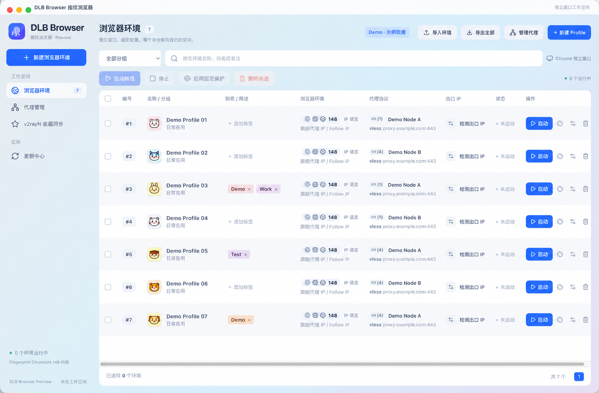

# DLB Browser

**English** | [简体中文](README.zh-CN.md)

Local-first multi-profile Chromium workspace for macOS Apple Silicon. Previously developed as Prism.




Sanitized demo: profile names, tags and proxy endpoints are fictional. Image edited for illustration.


### Features

- Separate browser processes and persistent data directories for cookies, local storage, bookmarks and extensions.
- Native Chromium windows sharing one engine installation, without reusing personal Chrome profiles.
- Per-profile direct, system proxy, SOCKS5 and Xray-backed VLESS connections.
- Read-only v2rayN import with user-selected favorites and defaults.
- A third-party native Fingerprint Chromium engine with stable profile numbers and fingerprint seeds.
- Timezone, locale, screen and hardware concurrency configuration and proxy-based location lookup.
- Generated account-name bookmarks are no longer added; user bookmarks are preserved.

### Evidence and limitations

Local tests cover storage separation, persistence, stable Canvas output, selected page/worker consistency, proxy configuration and selected live connections. See `tests/`. These tests do not prove compatibility with every website.

Audio collisions have been observed. Real WebRTC/STUN and DNS leakage, TLS and HTTP fingerprints have not been comprehensively audited. Unsupported device customizations are rejected. The current `password-store=basic` option is not suitable for relying on browser storage of sensitive credentials or payment details. Signed installation, automatic updates and rollback are incomplete. There is no guarantee against account association or website risk decisions.

The engine is third-party. Its pinned version and executable hash are in `resources/native/engine.json`; this is not a claim of current security patch coverage.

### Data and setup

The internal application identity and data directory remain compatible:
`$HOME/Library/Application Support/prism-fingerprint-browser/`.

Never commit runtime profiles, cookies, proxy credentials, access tokens, personal notes, logs or screenshots.

On macOS Apple Silicon, with Node.js and pnpm installed:

```sh
pnpm install
pnpm run typecheck
pnpm run build
pnpm run dev
```

Obtain a matching upstream engine separately, install it under `native/Chromium.app` in the user data directory and run `node scripts/prepare-native.mjs`. The compiled manager does not bundle Chromium. Always package to a fresh directory. Historical UI tests may be obsolete; inspect live network diagnostics before running them. Use temporary profiles for isolation tests.


## Third-party components / 第三方组件

- [Fingerprint Chromium](https://github.com/adryfish/fingerprint-chromium): native engine; review upstream licensing and release terms.
- [Xray-core](https://github.com/XTLS/Xray-core): proxy transport; bundled license files are in resources/licenses.
- Electron, React, Vite and other dependencies retain their respective licenses.

Review redistribution rights for binaries and artwork before public release. A private source backup is not a license clearance or production-security certification.
